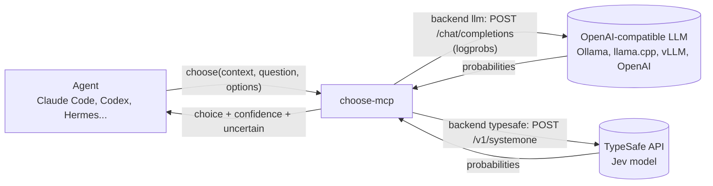

<div align="center">


[](https://www.npmjs.com/package/choose-mcp)
[](https://nodejs.org)
[](tsconfig.json)
[](https://modelcontextprotocol.io)
[](LICENSE)
[](https://github.com/PedroRamosPereira/choose-mcp/stargazers)

**English** · [Português](README.pt-BR.md)

</div>

An [MCP](https://modelcontextprotocol.io) server with one tool, **`choose`**. Your agent sends a context, a question and a list of options. The server answers with a choice, a probability for each option and an uncertainty flag.

Two interchangeable backends produce the probabilities:

- **`llm`**: any OpenAI-compatible LLM (Ollama, llama.cpp, vLLM, OpenAI). Probabilities come from the model's token logprobs. No account needed.
- **`typesafe`**: TypeSafe's Jev model, a decision-only model that returns typed probabilities. Optional.

The tool, its input and its output are the same on both.

## Quick start

No clone or build needed: the client starts the server through `npx`. Pick a backend:

```bash
# Any OpenAI-compatible LLM (here: a local Ollama)
claude mcp add choose -e CHOOSE_LLM_MODEL=qwen2.5:7b-instruct -- npx -y choose-mcp

# or TypeSafe's Jev
claude mcp add choose -e TYPESAFE_API_KEY=your-key -- npx -y choose-mcp
```

### As a Claude Code plugin (server + skill)

```text
/plugin marketplace add PedroRamosPereira/choose-mcp
/plugin install choose@choose-mcp
```

The plugin registers the MCP server and adds a `choose` skill that teaches the agent when and how to call the tool. It asks for the backend settings (LLM model and URL, or TypeSafe key); change them later with `claude plugin configure choose`.

To work on the code, run from source instead:

```bash
git clone https://github.com/PedroRamosPereira/choose-mcp.git && cd choose-mcp
npm install && npm run build
claude mcp add choose -e CHOOSE_LLM_MODEL=qwen2.5:7b-instruct -- node "$PWD/dist/index.js"
```

## Why

Agents pick between options all the time: which agent takes a task, how much effort it deserves, which result wins, which list items matter. When the LLM decides inside its own reply, you get an answer with no confidence attached.

`choose` turns that decision into a structured call:

- The answer is one of the options you passed in.
- Each option gets a probability.
- Below the confidence threshold, the answer carries `uncertain: true` and the agent asks you before acting.

## Highlight: picking the right effort

Max effort on every task burns tokens and time. Minimum effort fails hard tasks. Let the orchestrator ask for the *reasoning effort* before it delegates:

```json
{
  "context": { "task": "Fix a typo in the README" },
  "question": "What effort level does this task need?",
  "options": {
    "low": "Trivial, mechanical task with no multi-step reasoning",
    "medium": "Regular coding task with some context to read",
    "high": "Ambiguous task, architecture work or hard debugging"
  }
}
```

```json
{ "choice": "low", "confidence": 0.93, "probabilities": { "low": 0.93, "medium": 0.06, "high": 0.01 }, "uncertain": false }
```

Swap the options for model names and you get model routing. When the answer hesitates between `medium` and `high`, the `uncertain` flag stops the agent from picking the cheaper one on a guess.

## How it works



| Mode | What is asked | Use it for | Output |
| --- | --- | --- | --- |
| `single` | one `choice` question with every option | routing, picking the best result | `{ choice, confidence, probabilities, uncertain }` |
| `multi` | one yes/no question per option | filtering a list | `{ approved, probabilities, doubtful, uncertain }` |

In `multi` mode, an option passes at probability 0.5 or higher. Scores near 0.5 signal doubt: with a 0.6 threshold, anything between 0.4 and 0.6 lands in `doubtful`. A threshold of 0.5 or lower turns `doubtful` off, just as it never flags a two-option `single` decision (its confidence is always at least 0.5).

How each backend answers:

| | `typesafe` | `llm` |
| --- | --- | --- |
| `single` | one `choice` question | one call, options labelled A-Z (up to 26), probabilities from the logprobs of the first answer token |
| `multi` | one `noul` question per option, in one request | one Yes/No call per option, run in parallel (`CHOOSE_LLM_CONCURRENCY`) |
| Options | 2 to 255 | `single`: 2 to 26. `multi`: 2 to 255 |
| Calibration | done by the model | yours to tune (see [Calibration](#calibration)) |

## Example: routing a task

```json
{
  "context": { "task": "Refactor the payments module", "repository": "api-store" },
  "question": "Which agent should run this task?",
  "options": {
    "codex": "Agent focused on refactoring and backend code",
    "claude": "Agent focused on review, docs and writing",
    "none": "None of the agents fits this task"
  },
  "mode": "single"
}
```

```json
{
  "choice": "codex",
  "confidence": 0.87,
  "probabilities": { "codex": 0.87, "claude": 0.11, "none": 0.02 },
  "uncertain": false
}
```

## Configuration

### Choosing the backend

| `CHOOSE_BACKEND` | `TYPESAFE_API_KEY` | `CHOOSE_LLM_MODEL` | Backend |
| --- | --- | --- | --- |
| `typesafe` or `llm` | any | any | the one you set |
| (unset) | set | any | `typesafe` (so existing setups keep working) |
| (unset) | unset | set | `llm` |
| (unset) | unset | unset | error telling you to set one of the two |

### Variables

| Variable | Backend | Default | Description |
| --- | --- | --- | --- |
| `CHOOSE_BACKEND` | both | auto | `typesafe` or `llm` |
| `CHOOSE_THRESHOLD` | both | `0.6` | minimum confidence before flagging `uncertain`, between 0 and 1 |
| `TYPESAFE_API_KEY` | typesafe | | TypeSafe API key (required for this backend) |
| `JEV_MODEL` | typesafe | `jev-latest` | model version |
| `TYPESAFE_BASE_URL` | typesafe | `https://api.typesafe.ai` | API URL, used by the tests |
| `CHOOSE_LLM_MODEL` | llm | | model name, e.g. `qwen2.5:7b-instruct` or `gpt-4.1-mini` (required for this backend) |
| `CHOOSE_LLM_BASE_URL` | llm | `http://localhost:11434/v1` | any OpenAI-compatible `/v1` |
| `CHOOSE_LLM_API_KEY` | llm | | sent as a Bearer token when set |
| `CHOOSE_LLM_TEMPERATURE` | llm | `1` | temperature scaling for calibration (not the sampling temperature) |
| `CHOOSE_LLM_SAMPLES` | llm | `0` | `N > 0` estimates by sampling when the API returns no logprobs |
| `CHOOSE_LLM_CONCURRENCY` | llm | `4` | parallel calls in `multi` mode |
| `CHOOSE_LLM_TIMEOUT_MS` | llm | `60000` | timeout per call |

### The `llm` backend

It works with servers that return `logprobs` on `/v1/chat/completions`: OpenAI models without reasoning, vLLM, llama.cpp and recent Ollama (check your version; support for this through the OpenAI-compatible route has varied).

- Reasoning models (o-series, gpt-5) reject `logprobs` and return an error.
- Probability the model puts **outside** the allowed answers lowers `confidence` in `single` and pulls the score toward 0.5 in `multi`, so `uncertain` rises on its own.
- If the model answers entirely outside the allowed labels, the call fails with an error instead of guessing.
- In `multi` mode each option is one call that resends the whole context, so N options cost N times the context. Keep `context` lean for long lists. Servers with prefix caching (vLLM, llama.cpp) absorb part of the cost, since the context comes first in the prompt.
- APIs without logprobs (Anthropic's OpenAI layer) only work with `CHOOSE_LLM_SAMPLES=N`. Confidence then moves in steps of 1/N, so with `N=5` and a 0.6 threshold you need 3 of 5 matching answers.

## Calibration

A token probability is not the same as the chance of being right. Instruction-tuned models tend to be overconfident, so a 0.9 can be worth much less. The `typesafe` backend handles this itself. For `llm`, you tune one number, `CHOOSE_LLM_TEMPERATURE`: above 1 softens an overconfident model, below 1 sharpens it. The choice never changes, only the confidence.

Write 50 to 200 real decisions with the right answer, one JSON per line (see [`scripts/calib.example.jsonl`](scripts/calib.example.jsonl)):

```json
{"context": {"task": "Fix a typo"}, "question": "What effort level?", "options": {"low": "...", "medium": "...", "high": "..."}, "answer": "low"}
```

Then run:

```bash
CHOOSE_LLM_MODEL=qwen2.5:7b-instruct npm run calibrate -- calib.jsonl
```

It prints accuracy, the ECE before and after, the `CHOOSE_LLM_TEMPERATURE` to use, and a table of `CHOOSE_THRESHOLD` against how many decisions stay automatic and how accurate they are. Pick the lowest threshold that gives the accuracy you accept.

- The result holds for that model and that prompt. Recalibrate if either changes.
- It calibrates `single` mode only. `multi` scores are never scaled by `CHOOSE_LLM_TEMPERATURE`.
- If T lands on the edge of the search range (0.25 to 5), the script warns you: you probably need more examples, or the model fits the task poorly.

## Client setup

<details>
<summary><b>Claude Code</b></summary>

```bash
claude mcp add choose --scope user -e CHOOSE_LLM_MODEL=qwen2.5:7b-instruct -- npx -y choose-mcp
# or, with Jev:
claude mcp add choose --scope user -e TYPESAFE_API_KEY=your-key -- npx -y choose-mcp
```

</details>

<details>
<summary><b>Codex</b></summary>

```toml
# ~/.codex/config.toml
[mcp_servers.choose]
command = "npx"
args = ["-y", "choose-mcp"]
env = { CHOOSE_LLM_MODEL = "qwen2.5:7b-instruct" }   # or { TYPESAFE_API_KEY = "your-key" }
```

</details>

<details>
<summary><b>Hermes Agent</b></summary>

Hermes doesn't forward environment variables to MCP servers. Put them in the `env` block of `~/.hermes/config.yaml`:

```yaml
mcp_servers:
  choose:
    command: "npx"
    args: ["-y", "choose-mcp"]
    env:
      CHOOSE_LLM_MODEL: "qwen2.5:7b-instruct"   # or TYPESAFE_API_KEY: "your-key"
```

Then run `/reload-mcp` in the chat.

</details>

<details>
<summary><b>OpenBot</b></summary>

OpenBot runs agents through their CLIs (Claude Code, Codex and others). Register the server in the CLI your agent uses, as shown above.

</details>

> [!TIP]
> With `uncertain: true` and no rule, the agent stops and shows you the options. To let it decide alone, add to its instructions:
> ```text
> When choose returns uncertain=true, go with the highest-probability option and note that in your answer.
> ```

## Letting the agent use it on its own

The agent should call `choose` when a decision shows up, without you naming the tool. Three layers handle that:

1. **Server instructions** (every MCP client): the server sends a short "when to call, when not to" guide in the MCP handshake. Clients such as Claude Code put it in the model's system prompt, even when tool schemas are deferred.
2. **Skill** (Claude Code plugin): the `choose` skill loads on demand and teaches how to build a good call, with ready-made patterns for routing, effort and filtering.
3. **A rule in your instructions** (any client, e.g. `CLAUDE.md` or `AGENTS.md`):

```text
Before delegating a task, picking an effort level or model, choosing among results or filtering a list, call the choose tool instead of deciding in your head. Skip it when only one option is reasonable.
```

The guide also tells the agent when **not** to call it: every call goes to another model, so trivial or already-decided choices stay with the agent.

## Project structure

```text
choose-mcp/
├── .claude-plugin/   # Claude Code plugin and marketplace manifests
├── .mcp.json         # MCP server registration used by the plugin
├── skills/choose/
│   └── SKILL.md      # skill: when and how to call choose
├── src/
│   ├── index.ts      # MCP server, instructions, tool schema, backend selection and the Jev call
│   └── llm.ts        # llm backend: logprobs, temperature scaling, sampling fallback
├── scripts/
│   ├── calibrate.mjs         # finds CHOOSE_LLM_TEMPERATURE and a threshold from labelled examples
│   └── calib.example.jsonl   # example input
├── test/
│   └── e2e.mjs       # fake TypeSafe + OpenAI-compatible API, real MCP client over stdio
├── package.json
└── tsconfig.json
```

## Technical decisions

- **Two dependencies**: the official MCP SDK and Zod. HTTP goes through Node's native `fetch`.
- **Backends without an abstraction**: two functions with the same signature, picked by one `if`. `llm.ts` is a separate file because `index.ts` starts the server on import, which would make its pure functions untestable.
- **Validation at the boundary**: Zod rejects fewer than 2 or more than 255 options, and thresholds outside 0 to 1, before the server spends an API call. An invalid `CHOOSE_THRESHOLD` stops the server at startup instead of silently disabling `uncertain`.
- **Doubt is not discarded**: logprob mass outside the allowed labels counts as uncertainty, so the output format needs no extra field.
- **Structured output**: the tool declares an `outputSchema` and returns `structuredContent`, so clients can validate the result and agents read typed fields.
- **Errors as results**: API failures return to the agent as `isError`, so it can retry or tell you. The `llm` backend retries 429 and 5xx twice before failing.
- **Free end-to-end test**: `npm test` starts a local server that mimics both APIs, connects a real MCP client and checks both modes, both backends and the error cases.

## Star history

<a href="https://star-history.com/#PedroRamosPereira/choose-mcp&Date">
  <picture>
    <source media="(prefers-color-scheme: dark)" srcset="https://api.star-history.com/svg?repos=PedroRamosPereira/choose-mcp&type=Date&theme=dark">
    
  </picture>
</a>

## License

[ISC](LICENSE) © Pedro Ramos Pereira
