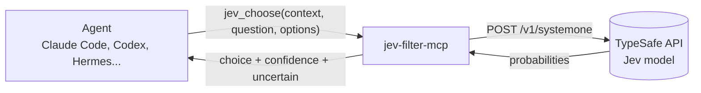

<div align="center">


[](https://nodejs.org)
[](tsconfig.json)
[](https://modelcontextprotocol.io)
[](LICENSE)
[](https://github.com/PedroRamosPereira/jev-mcp/stargazers)

**English** · [Português](README.pt-BR.md)

</div>

An [MCP](https://modelcontextprotocol.io) server with one tool, **`jev_choose`**. Your agent sends a context, a question and a list of options. TypeSafe's Jev model answers with a choice, a probability for each option and an uncertainty flag.

## Quick start

```bash
git clone https://github.com/PedroRamosPereira/jev-mcp.git && cd jev-mcp
npm install && npm run build
claude mcp add jev -e TYPESAFE_API_KEY=your-key -- node "$PWD/dist/index.js"
```

## Why

Agents pick between options all the time: which agent takes a task, how much effort it deserves, which result wins, which list items matter. When the LLM decides inside its own reply, you get an answer with no confidence attached.

`jev_choose` turns that decision into a structured call:

- Jev answers with one of the options you passed in.
- Each option gets a probability.
- Below the confidence threshold, the answer carries `uncertain: true` and the agent asks you before acting.

## Highlight: picking the right effort

Max effort on every task burns tokens and time. Minimum effort fails hard tasks. Let the orchestrator ask Jev for the *reasoning effort* before it delegates:

```json
{
  "context": { "task": "Fix a typo in the README" },
  "question": "What effort level does this task need?",
  "options": {
    "low": "Trivial, mechanical task with no multi-step reasoning",
    "medium": "Regular coding task with some context to read",
    "high": "Ambiguous task, architecture work or hard debugging"
  }
}
```

```json
{ "choice": "low", "confidence": 0.93, "probabilities": { "low": 0.93, "medium": 0.06, "high": 0.01 }, "uncertain": false }
```

Swap the options for model names and you get model routing. When Jev hesitates between `medium` and `high`, the `uncertain` flag stops the agent from picking the cheaper one on a guess.

## How it works



| Mode | Question sent to Jev | Use it for | Output |
| --- | --- | --- | --- |
| `single` | one `choice` question with every option | routing, picking the best result | `{ choice, confidence, probabilities, uncertain }` |
| `multi` | one yes/no `noul` question per option | filtering a list | `{ approved, probabilities, doubtful, uncertain }` |

In `multi` mode, an option passes at probability 0.5 or higher. Scores near 0.5 signal doubt: with a 0.6 threshold, anything between 0.4 and 0.6 lands in `doubtful`.

## Example: routing a task

```json
{
  "context": { "task": "Refactor the payments module", "repository": "api-store" },
  "question": "Which agent should run this task?",
  "options": {
    "codex": "Agent focused on refactoring and backend code",
    "claude": "Agent focused on review, docs and writing",
    "none": "None of the agents fits this task"
  },
  "mode": "single"
}
```

```json
{
  "choice": "codex",
  "confidence": 0.87,
  "probabilities": { "codex": 0.87, "claude": 0.11, "none": 0.02 },
  "uncertain": false
}
```

## Configuration

| Variable | Required | Default | Description |
| --- | --- | --- | --- |
| `TYPESAFE_API_KEY` | yes | | TypeSafe API key |
| `JEV_MODEL` | no | `jev-latest` | model version |
| `JEV_THRESHOLD` | no | `0.6` | minimum confidence before flagging `uncertain` |
| `TYPESAFE_BASE_URL` | no | `https://api.typesafe.ai` | API URL, used by the tests |

<details>
<summary><b>Claude Code</b></summary>

```bash
claude mcp add jev --scope user -e TYPESAFE_API_KEY=your-key -- node /path/to/jev-mcp/dist/index.js
```

</details>

<details>
<summary><b>Codex</b></summary>

```toml
# ~/.codex/config.toml
[mcp_servers.jev]
command = "node"
args = ["/path/to/jev-mcp/dist/index.js"]
env = { TYPESAFE_API_KEY = "your-key" }
```

</details>

<details>
<summary><b>Hermes Agent</b></summary>

Hermes doesn't forward environment variables to MCP servers. Put the key in the `env` block of `~/.hermes/config.yaml`:

```yaml
mcp_servers:
  jev:
    command: "node"
    args: ["/path/to/jev-mcp/dist/index.js"]
    env:
      TYPESAFE_API_KEY: "your-key"
```

Then run `/reload-mcp` in the chat.

</details>

<details>
<summary><b>OpenBot</b></summary>

OpenBot runs agents through their CLIs (Claude Code, Codex and others). Register the server in the CLI your agent uses, as shown above.

</details>

> [!TIP]
> With `uncertain: true` and no rule, the agent stops and shows you the options. To let it decide alone, add to its instructions:
> ```text
> When jev_choose returns uncertain=true, go with the highest-probability option and note that in your answer.
> ```

## Project structure

```text
jev-mcp/
├── src/
│   └── index.ts      # MCP server, tool schema and the Jev call
├── test/
│   └── e2e.mjs       # fake TypeSafe API + real MCP client over stdio
├── package.json
└── tsconfig.json
```

## Technical decisions

- **Two dependencies**: the official MCP SDK and Zod. HTTP goes through Node's native `fetch`.
- **Validation at the boundary**: Zod rejects fewer than 2 or more than 255 options, and thresholds outside 0 to 1, before the server spends an API call.
- **Errors as results**: API failures return to the agent as `isError`, so it can retry or tell you.
- **Free end-to-end test**: `npm test` starts a local server that mimics the API, connects a real MCP client and checks both modes plus the error case.

## Star history

<a href="https://star-history.com/#PedroRamosPereira/jev-mcp&Date">
  <picture>
    <source media="(prefers-color-scheme: dark)" srcset="https://api.star-history.com/svg?repos=PedroRamosPereira/jev-mcp&type=Date&theme=dark">
    
  </picture>
</a>

## License

[ISC](LICENSE) © Pedro Ramos Pereira
