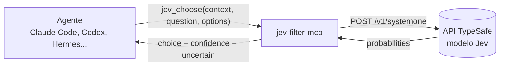

<div align="center">


[](https://nodejs.org)
[](tsconfig.json)
[](https://modelcontextprotocol.io)
[](LICENSE)
[](https://github.com/PedroRamosPereira/jev-mcp/stargazers)

[English](README.md) · **Português**

</div>

Servidor [MCP](https://modelcontextprotocol.io) com uma ferramenta, **`jev_choose`**. Seu agente envia um contexto, uma pergunta e uma lista de opções. O modelo Jev, da TypeSafe, responde com a escolha, a probabilidade de cada opção e um sinal de incerteza.

## Início rápido

```bash
git clone https://github.com/PedroRamosPereira/jev-mcp.git && cd jev-mcp
npm install && npm run build
claude mcp add jev -e TYPESAFE_API_KEY=sua-chave -- node "$PWD/dist/index.js"
```

## Por que existe

Agentes escolhem entre opções o tempo todo: qual agente pega a tarefa, quanto esforço ela merece, qual resultado é o melhor, quais itens de uma lista importam. Quando o LLM decide no meio da própria resposta, você recebe a decisão sem nenhuma medida de confiança.

O `jev_choose` transforma essa decisão numa chamada estruturada:

- O Jev responde com uma das opções que você passou.
- Cada opção recebe uma probabilidade.
- Abaixo do limiar de confiança, a resposta traz `uncertain: true` e o agente pergunta a você antes de agir.

## Destaque: escolher o effort certo

Esforço máximo em toda tarefa gasta tokens e tempo. Esforço mínimo erra tarefas difíceis. Deixe o orquestrador perguntar ao Jev o nível de esforço (*reasoning effort*) antes de delegar:

```json
{
  "context": { "task": "Corrigir um erro de digitação no README" },
  "question": "Qual nível de esforço esta tarefa exige?",
  "options": {
    "low": "Tarefa trivial e mecânica, sem raciocínio em várias etapas",
    "medium": "Tarefa comum de código, com algum contexto para ler",
    "high": "Tarefa ambígua, de arquitetura ou depuração difícil"
  }
}
```

```json
{ "choice": "low", "confidence": 0.93, "probabilities": { "low": 0.93, "medium": 0.06, "high": 0.01 }, "uncertain": false }
```

Troque as opções por nomes de modelos e você tem roteamento de modelo. Quando o Jev fica entre `medium` e `high`, o sinal `uncertain` impede o agente de escolher o mais barato no chute.

## Como funciona



| Modo | Pergunta enviada ao Jev | Use para | Saída |
| --- | --- | --- | --- |
| `single` | uma pergunta `choice` com todas as opções | roteamento, escolher o melhor resultado | `{ choice, confidence, probabilities, uncertain }` |
| `multi` | uma pergunta sim/não (`noul`) por opção | filtrar uma lista | `{ approved, probabilities, doubtful, uncertain }` |

No modo `multi`, uma opção passa com probabilidade de 0,5 ou mais. Valores perto de 0,5 indicam dúvida: com limiar 0,6, tudo entre 0,4 e 0,6 vai para `doubtful`.

## Exemplo: rotear uma tarefa

```json
{
  "context": { "task": "Refatorar o módulo de pagamentos", "repository": "api-loja" },
  "question": "Qual agente deve executar esta tarefa?",
  "options": {
    "codex": "Agente focado em refatoração e código backend",
    "claude": "Agente focado em revisão, documentação e texto",
    "none": "Nenhum dos agentes serve para esta tarefa"
  },
  "mode": "single"
}
```

```json
{
  "choice": "codex",
  "confidence": 0.87,
  "probabilities": { "codex": 0.87, "claude": 0.11, "none": 0.02 },
  "uncertain": false
}
```

## Configuração

| Variável | Obrigatória | Padrão | Descrição |
| --- | --- | --- | --- |
| `TYPESAFE_API_KEY` | sim | | chave da API TypeSafe |
| `JEV_MODEL` | não | `jev-latest` | versão do modelo |
| `JEV_THRESHOLD` | não | `0.6` | confiança mínima antes de marcar `uncertain` |
| `TYPESAFE_BASE_URL` | não | `https://api.typesafe.ai` | URL da API, usada nos testes |

<details>
<summary><b>Claude Code</b></summary>

```bash
claude mcp add jev --scope user -e TYPESAFE_API_KEY=sua-chave -- node /caminho/para/jev-mcp/dist/index.js
```

</details>

<details>
<summary><b>Codex</b></summary>

```toml
# ~/.codex/config.toml
[mcp_servers.jev]
command = "node"
args = ["/caminho/para/jev-mcp/dist/index.js"]
env = { TYPESAFE_API_KEY = "sua-chave" }
```

</details>

<details>
<summary><b>Hermes Agent</b></summary>

O Hermes não repassa variáveis de ambiente para servidores MCP. Coloque a chave no bloco `env` de `~/.hermes/config.yaml`:

```yaml
mcp_servers:
  jev:
    command: "node"
    args: ["/caminho/para/jev-mcp/dist/index.js"]
    env:
      TYPESAFE_API_KEY: "sua-chave"
```

Depois rode `/reload-mcp` no chat.

</details>

<details>
<summary><b>OpenBot</b></summary>

O OpenBot executa os agentes pelas CLIs (Claude Code, Codex e outras). Registre o servidor na CLI que o seu agente usa, como acima.

</details>

> [!TIP]
> Com `uncertain: true` e sem regra, o agente para e mostra as opções a você. Para deixá-lo decidir sozinho, adicione às instruções dele:
> ```text
> Quando jev_choose retornar uncertain=true, siga com a opção de maior probabilidade e registre isso na resposta.
> ```

## Estrutura

```text
jev-mcp/
├── src/
│   └── index.ts      # servidor MCP, schema da ferramenta e chamada ao Jev
├── test/
│   └── e2e.mjs       # API TypeSafe falsa + cliente MCP real via stdio
├── package.json
└── tsconfig.json
```

## Decisões técnicas

- **Duas dependências**: o SDK oficial do MCP e o Zod. O HTTP usa o `fetch` nativo do Node.
- **Validação na borda**: o Zod rejeita menos de 2 ou mais de 255 opções, e limiar fora de 0 a 1, antes de o servidor gastar uma chamada de API.
- **Erros como resultado**: falhas da API voltam ao agente como `isError`, e ele pode tentar de novo ou avisar você.
- **Teste ponta a ponta de graça**: `npm test` sobe um servidor local que imita a API, conecta um cliente MCP real e valida os dois modos e o caso de erro.

## Histórico de estrelas

<a href="https://star-history.com/#PedroRamosPereira/jev-mcp&Date">
  <picture>
    <source media="(prefers-color-scheme: dark)" srcset="https://api.star-history.com/svg?repos=PedroRamosPereira/jev-mcp&type=Date&theme=dark">
    
  </picture>
</a>

## Licença

[ISC](LICENSE) © Pedro Ramos Pereira
