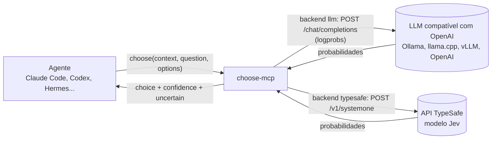

<div align="center">


[](https://www.npmjs.com/package/choose-mcp)
[](https://nodejs.org)
[](tsconfig.json)
[](https://modelcontextprotocol.io)
[](LICENSE)
[](https://github.com/PedroRamosPereira/choose-mcp/stargazers)

[English](README.md) · **Português**

</div>

Servidor [MCP](https://modelcontextprotocol.io) com uma ferramenta, **`choose`**. Seu agente envia um contexto, uma pergunta e uma lista de opções. O servidor responde com a escolha, a probabilidade de cada opção e um sinal de incerteza.

Dois backends intercambiáveis produzem as probabilidades:

- **`llm`**: qualquer LLM compatível com OpenAI (Ollama, llama.cpp, vLLM, OpenAI). As probabilidades vêm dos logprobs dos tokens do modelo. Não precisa de conta.
- **`typesafe`**: o modelo Jev da TypeSafe, que só decide e devolve probabilidades tipadas. Opcional.

A ferramenta, a entrada e a saída são as mesmas nos dois.

## Início rápido

Não precisa clonar nem compilar: o cliente sobe o servidor pelo `npx`. Escolha um backend:

```bash
# Qualquer LLM compatível com OpenAI (aqui: um Ollama local)
claude mcp add choose -e CHOOSE_LLM_MODEL=qwen2.5:7b-instruct -- npx -y choose-mcp

# ou o Jev da TypeSafe
claude mcp add choose -e TYPESAFE_API_KEY=sua-chave -- npx -y choose-mcp
```

Para mexer no código, rode a partir do fonte:

```bash
git clone https://github.com/PedroRamosPereira/choose-mcp.git && cd choose-mcp
npm install && npm run build
claude mcp add choose -e CHOOSE_LLM_MODEL=qwen2.5:7b-instruct -- node "$PWD/dist/index.js"
```

## Por que existe

Agentes escolhem entre opções o tempo todo: qual agente pega a tarefa, quanto esforço ela merece, qual resultado é o melhor, quais itens de uma lista importam. Quando o LLM decide no meio da própria resposta, você recebe a decisão sem nenhuma medida de confiança.

O `choose` transforma essa decisão numa chamada estruturada:

- A resposta é uma das opções que você passou.
- Cada opção recebe uma probabilidade.
- Abaixo do limiar de confiança, a resposta traz `uncertain: true` e o agente pergunta a você antes de agir.

## Destaque: escolher o effort certo

Esforço máximo em toda tarefa gasta tokens e tempo. Esforço mínimo erra tarefas difíceis. Deixe o orquestrador perguntar o nível de esforço (*reasoning effort*) antes de delegar:

```json
{
  "context": { "task": "Corrigir um erro de digitação no README" },
  "question": "Qual nível de esforço esta tarefa exige?",
  "options": {
    "low": "Tarefa trivial e mecânica, sem raciocínio em várias etapas",
    "medium": "Tarefa comum de código, com algum contexto para ler",
    "high": "Tarefa ambígua, de arquitetura ou depuração difícil"
  }
}
```

```json
{ "choice": "low", "confidence": 0.93, "probabilities": { "low": 0.93, "medium": 0.06, "high": 0.01 }, "uncertain": false }
```

Troque as opções por nomes de modelos e você tem roteamento de modelo. Quando a resposta fica entre `medium` e `high`, o sinal `uncertain` impede o agente de escolher o mais barato no chute.

## Como funciona



| Modo | O que é perguntado | Use para | Saída |
| --- | --- | --- | --- |
| `single` | uma pergunta `choice` com todas as opções | roteamento, escolher o melhor resultado | `{ choice, confidence, probabilities, uncertain }` |
| `multi` | uma pergunta sim/não por opção | filtrar uma lista | `{ approved, probabilities, doubtful, uncertain }` |

No modo `multi`, uma opção passa com probabilidade de 0,5 ou mais. Valores perto de 0,5 indicam dúvida: com limiar 0,6, tudo entre 0,4 e 0,6 vai para `doubtful`.

Como cada backend responde:

| | `typesafe` | `llm` |
| --- | --- | --- |
| `single` | uma pergunta `choice` | uma chamada, opções rotuladas A-Z (até 26), probabilidades dos logprobs do primeiro token da resposta |
| `multi` | uma pergunta `noul` por opção, numa só requisição | uma chamada Sim/Não por opção, em paralelo (`CHOOSE_LLM_CONCURRENCY`) |
| Opções | 2 a 255 | `single`: 2 a 26. `multi`: 2 a 255 |
| Calibração | feita pelo modelo | por sua conta (veja [Calibração](#calibração)) |

## Exemplo: rotear uma tarefa

```json
{
  "context": { "task": "Refatorar o módulo de pagamentos", "repository": "api-loja" },
  "question": "Qual agente deve executar esta tarefa?",
  "options": {
    "codex": "Agente focado em refatoração e código backend",
    "claude": "Agente focado em revisão, documentação e texto",
    "none": "Nenhum dos agentes serve para esta tarefa"
  },
  "mode": "single"
}
```

```json
{
  "choice": "codex",
  "confidence": 0.87,
  "probabilities": { "codex": 0.87, "claude": 0.11, "none": 0.02 },
  "uncertain": false
}
```

## Configuração

### Escolhendo o backend

| `CHOOSE_BACKEND` | `TYPESAFE_API_KEY` | `CHOOSE_LLM_MODEL` | Backend |
| --- | --- | --- | --- |
| `typesafe` ou `llm` | qualquer | qualquer | o que você definiu |
| (vazio) | definida | qualquer | `typesafe` (quem já usa continua funcionando) |
| (vazio) | vazia | definida | `llm` |
| (vazio) | vazia | vazia | erro pedindo para definir uma das duas |

### Variáveis

| Variável | Backend | Padrão | Descrição |
| --- | --- | --- | --- |
| `CHOOSE_BACKEND` | ambos | auto | `typesafe` ou `llm` |
| `CHOOSE_THRESHOLD` | ambos | `0.6` | confiança mínima antes de marcar `uncertain`, entre 0 e 1 |
| `TYPESAFE_API_KEY` | typesafe | | chave da API TypeSafe (obrigatória neste backend) |
| `JEV_MODEL` | typesafe | `jev-latest` | versão do modelo |
| `TYPESAFE_BASE_URL` | typesafe | `https://api.typesafe.ai` | URL da API, usada nos testes |
| `CHOOSE_LLM_MODEL` | llm | | nome do modelo, ex.: `qwen2.5:7b-instruct` ou `gpt-4.1-mini` (obrigatória neste backend) |
| `CHOOSE_LLM_BASE_URL` | llm | `http://localhost:11434/v1` | qualquer `/v1` compatível com OpenAI |
| `CHOOSE_LLM_API_KEY` | llm | | enviada como Bearer quando definida |
| `CHOOSE_LLM_TEMPERATURE` | llm | `1` | temperature scaling para calibrar (não é a temperatura de amostragem) |
| `CHOOSE_LLM_SAMPLES` | llm | `0` | `N > 0` estima por amostragem quando a API não devolve logprobs |
| `CHOOSE_LLM_CONCURRENCY` | llm | `4` | chamadas paralelas no modo `multi` |
| `CHOOSE_LLM_TIMEOUT_MS` | llm | `60000` | timeout por chamada |

### O backend `llm`

Funciona com servidores que devolvem `logprobs` em `/v1/chat/completions`: modelos OpenAI sem raciocínio, vLLM, llama.cpp e Ollama recente (confira a sua versão; o suporte por essa rota compatível com OpenAI variou).

- Modelos de raciocínio (o-series, gpt-5) rejeitam `logprobs` e devolvem erro.
- A probabilidade que o modelo põe **fora** das respostas permitidas reduz a `confidence` no `single` e puxa o score para 0,5 no `multi`, então `uncertain` sobe sozinho.
- Se o modelo responde inteiramente fora dos rótulos, a chamada falha com erro em vez de chutar.
- APIs sem logprobs (camada OpenAI da Anthropic) só funcionam com `CHOOSE_LLM_SAMPLES=N`. A confiança passa a andar em passos de 1/N: com `N=5` e limiar 0,6, são necessárias 3 de 5 respostas iguais.

## Calibração

Probabilidade de token não é a mesma coisa que chance de acerto. Modelos ajustados para instruções tendem a ser superconfiantes, então um 0,9 pode valer bem menos. O backend `typesafe` cuida disso sozinho. No `llm`, você ajusta um número, o `CHOOSE_LLM_TEMPERATURE`: acima de 1 suaviza um modelo superconfiante, abaixo de 1 deixa mais incisivo. A escolha nunca muda, só a confiança.

Escreva de 50 a 200 decisões reais com a resposta certa, um JSON por linha (veja [`scripts/calib.example.jsonl`](scripts/calib.example.jsonl)):

```json
{"context": {"task": "Corrigir um typo"}, "question": "Qual esforço?", "options": {"low": "...", "medium": "...", "high": "..."}, "answer": "low"}
```

Depois rode:

```bash
CHOOSE_LLM_MODEL=qwen2.5:7b-instruct npm run calibrate -- calib.jsonl
```

Ele mostra a acurácia, o ECE antes e depois, o `CHOOSE_LLM_TEMPERATURE` a usar, e uma tabela de `CHOOSE_THRESHOLD` contra quantas decisões ficam automáticas e com qual acurácia. Escolha o menor limiar que dá a acurácia que você aceita.

- O resultado vale para aquele modelo e aquele prompt. Recalibre se um dos dois mudar.
- Calibra só o modo `single`.
- Se o T cair na borda da faixa de busca (0,25 a 5), o script avisa: provavelmente faltam exemplos, ou o modelo serve mal para a tarefa.

## Configuração por cliente

<details>
<summary><b>Claude Code</b></summary>

```bash
claude mcp add choose --scope user -e CHOOSE_LLM_MODEL=qwen2.5:7b-instruct -- npx -y choose-mcp
# ou, com o Jev:
claude mcp add choose --scope user -e TYPESAFE_API_KEY=sua-chave -- npx -y choose-mcp
```

</details>

<details>
<summary><b>Codex</b></summary>

```toml
# ~/.codex/config.toml
[mcp_servers.choose]
command = "npx"
args = ["-y", "choose-mcp"]
env = { CHOOSE_LLM_MODEL = "qwen2.5:7b-instruct" }   # ou { TYPESAFE_API_KEY = "sua-chave" }
```

</details>

<details>
<summary><b>Hermes Agent</b></summary>

O Hermes não repassa variáveis de ambiente para servidores MCP. Coloque-as no bloco `env` de `~/.hermes/config.yaml`:

```yaml
mcp_servers:
  choose:
    command: "npx"
    args: ["-y", "choose-mcp"]
    env:
      CHOOSE_LLM_MODEL: "qwen2.5:7b-instruct"   # ou TYPESAFE_API_KEY: "sua-chave"
```

Depois rode `/reload-mcp` no chat.

</details>

<details>
<summary><b>OpenBot</b></summary>

O OpenBot executa os agentes pelas CLIs (Claude Code, Codex e outras). Registre o servidor na CLI que o seu agente usa, como acima.

</details>

> [!TIP]
> Com `uncertain: true` e sem regra, o agente para e mostra as opções a você. Para deixá-lo decidir sozinho, adicione às instruções dele:
> ```text
> Quando choose retornar uncertain=true, siga com a opção de maior probabilidade e registre isso na resposta.
> ```

## Estrutura

```text
choose-mcp/
├── src/
│   ├── index.ts      # servidor MCP, schema da ferramenta, escolha do backend e chamada ao Jev
│   └── llm.ts        # backend llm: logprobs, temperature scaling, fallback por amostragem
├── scripts/
│   ├── calibrate.mjs         # acha o CHOOSE_LLM_TEMPERATURE e um limiar a partir de exemplos rotulados
│   └── calib.example.jsonl   # exemplo de entrada
├── test/
│   └── e2e.mjs       # API TypeSafe e compatível com OpenAI falsas + cliente MCP real via stdio
├── package.json
└── tsconfig.json
```

## Decisões técnicas

- **Duas dependências**: o SDK oficial do MCP e o Zod. O HTTP usa o `fetch` nativo do Node.
- **Backends sem abstração**: duas funções com a mesma assinatura, escolhidas por um `if`. O `llm.ts` é um arquivo separado porque o `index.ts` sobe o servidor ao ser importado, o que impediria testar as funções puras.
- **Validação na borda**: o Zod rejeita menos de 2 ou mais de 255 opções, e limiar fora de 0 a 1, antes de o servidor gastar uma chamada de API. Um `CHOOSE_THRESHOLD` inválido derruba o servidor na partida em vez de desligar o `uncertain` em silêncio.
- **Dúvida não é descartada**: massa de logprob fora dos rótulos permitidos conta como incerteza, então o formato de saída não precisa de campo extra.
- **Erros como resultado**: falhas da API voltam ao agente como `isError`, e ele pode tentar de novo ou avisar você. O backend `llm` tenta 429 e 5xx duas vezes antes de falhar.
- **Teste ponta a ponta de graça**: `npm test` sobe um servidor local que imita as duas APIs, conecta um cliente MCP real e valida os dois modos, os dois backends e os casos de erro.

## Histórico de estrelas

<a href="https://star-history.com/#PedroRamosPereira/choose-mcp&Date">
  <picture>
    <source media="(prefers-color-scheme: dark)" srcset="https://api.star-history.com/svg?repos=PedroRamosPereira/choose-mcp&type=Date&theme=dark">
    
  </picture>
</a>

## Licença

[ISC](LICENSE) © Pedro Ramos Pereira
